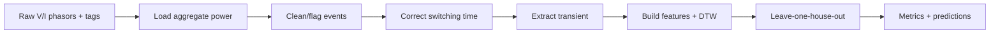
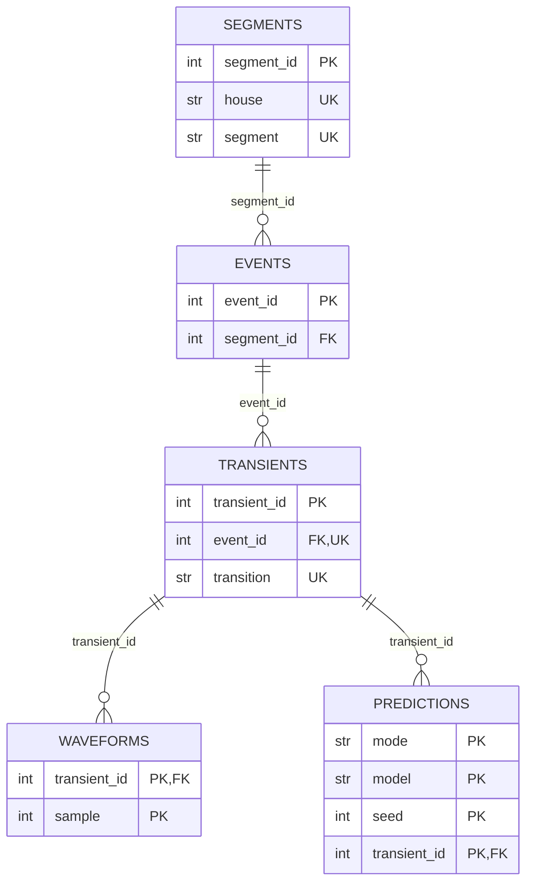

# Energy Disaggregation from Smart-Meter Transients

Classification of household appliances from the power transient at the moment
they switch on or off, using whole-house smart-meter data. The pipeline locates
the switching step near each hand-made tag, extracts the transient, builds
summary-statistic and dynamic-time-warping (DTW) features, and evaluates a random
forest, k-nearest neighbours and three baselines with leave-one-house-out
cross-validation over ten random seeds. The five appliances are toaster,
microwave, hair dryer, oven and computer.

## Dataset

The data comes from the Belkin Energy Disaggregation Competition on Kaggle
(Belkin1 et al., 2013). It is not part of this repository; download it from the
[competition page](https://www.kaggle.com/competitions/belkin-energy-disaggregation-competition).
[data/README.md](data/README.md) describes where to unpack it, the folder layout
and the quirks the code handles.

### Citation

```bibtex
@misc{belkin-energy-disaggregation-competition,
    author = {Belkin1 and HenryC and jcvd and Jinesh  and Karthik S and Kevin Ashton and Sidhant Gupta and Will Cukierski},
    title = {Belkin Energy Disaggregation Competition},
    year = {2013},
    howpublished = {\url{https://www.kaggle.com/competitions/belkin-energy-disaggregation-competition}},
    note = {Kaggle}
}
```

The transient-and-DTW approach follows Iwayemi & Zhou, *Leveraging Smart Meters
for Residential Energy Disaggregation* (IEEE, 2014).

## Pipeline



| Module | Contents |
|---|---|
| `nilm/data.py` | reading tags, timestamps and phasors; real power; the `.npz` cache |
| `nilm/events.py` | tag checks: target appliance, duration, overlaps, rare classes |
| `nilm/transients.py` | locating the switching step and extracting the waveform |
| `nilm/features.py` | statistics, DTW, medoid prototypes, feature matrix |
| `nilm/evaluation.py` | leave-one-house-out evaluation, models, seeds, permutation importance |
| `nilm/schema.py` | table definitions, validation, data dictionary and ER diagram |
| `nilm/pipeline.py` | runs the stages in order; command-line entry point |
| `nilm/plots.py` | optional figures |
| `nilm/config.py` | shared defaults |

## Data model

The tables are defined in `nilm/schema.py`. [docs/data_dictionary.md](docs/data_dictionary.md)
is generated from it and lists every column. The diagram below is generated from
the same definitions (PK = primary key, FK = foreign key, UK = unique key).



- Segments, events and transients have single-column surrogate keys. Their natural keys, `(house, segment)` and `(event_id, transition)`, are declared unique.
- Each table stores only its own attributes; house and appliance are reached through the foreign keys.
- `waveforms` and `predictions` have composite primary keys that match their grain: one sample of a transient, and one prediction per mode, model, seed and transient.
- `metrics`, `fold_metrics`, `feature_importance` and `quality_report` are summaries. Their primary keys are their grouping columns and they have no foreign keys.
- A row that fails a check stays in its table, with the failed check as its `status`.

| File | One row per | Primary key | Rows |
|---|---|---|---|
| `data/segments.csv` | tagged day folder | `segment_id` | 15 |
| `data/events.csv` | tag | `event_id` | 463 |
| `data/transients.csv` | turn-on or turn-off of a used event | `transient_id` | 72 |
| `data/waveforms.csv` | sample of an extracted transient | `transient_id`, `sample` | 1,272 |
| `data/quality_report.csv` | data check | `stage`, `check` | 18 |
| `results/predictions.csv` | held-out prediction | `mode`, `model`, `seed`, `transient_id` | 8,400 |
| `results/metrics.csv` | model in one mode | `mode`, `model` | 18 |
| `results/fold_metrics.csv` | model in one mode on one held-out house | `mode`, `model`, `house` | 72 |
| `results/feature_importance.csv` | feature in one mode | `mode`, `feature` | 48 |

The output directory also contains `run_info.json` (arguments, configuration,
library versions and row counts), `cache/` (parsed power per segment) and,
with `--plots`, `figures/`. `nilm.schema.read_table` reads a table back with
the declared types.

## Validation

**Raw input.** A non-numeric timestamp, an LF line that doesn't parse, or a row
with the wrong number of values raises an error naming the file and line. A
segment with unreadable phase-1 files gets status `load_failed` in
`segments.csv`; a missing phase 2 is flagged and phase 1 is used alone.

**Data checks.** Each check excludes a row (it stays in its table with the check
as `status`), flags it, or fixes it during loading. `data/quality_report.csv`
holds the counts for every run:

| Stage | Check | Action | Count |
|---|---|---|---|
| segments | `not_needed`: no usable events in that day | exclude | 7 of 15 |
| segments | `rows_trimmed`: LF/TimeTicks files differ in length | fix | 33 samples |
| segments | `out_of_order_timestamps`: clock jumps back around midnight | fix | 128 samples |
| events | `not_target`: another appliance | exclude | 424 of 463 |
| events | `zero_duration`: tag end equals tag start | exclude | 3 |
| events | `has_overlap`: overlaps another tag | flag | 0 |
| transients | `no_step_found`: no step within ±45 s | exclude | 2 of 72 |
| transients | `too_short`, `implausible_power` | exclude | 0 |
| transients | `unstable_baseline`: busy 6 s before the step | flag | 12 of 70 |

**Schema.** Before anything is written, each table is checked for missing
columns, wrong types, empty values in required columns, values outside the
allowed sets, and duplicate primary or unique keys. Every foreign key is checked
against its parent table. A violation stops the run with a `SchemaError`.

**Evaluation.** Each fold holds out one house. The DTW prototypes, the feature
scaler and the classifier are fitted on the remaining houses; the held-out house
is used only for prediction. `tests/test_evaluation.py` replaces the held-out
house's waveforms with scaled copies and checks that the training features,
scaler and prototypes stay identical. Every model runs with seeds 0–9.

**Tests.** 55 tests on synthetic data cover loading, the cache, event checks,
step detection, features, the evaluation folds and the schema. GitHub Actions
runs them on every push and checks that `docs/data_dictionary.md` matches the
schema.

## Method

**Aggregate power.** Real power is `Re(V · conj(I))` summed over the six
harmonic columns and both phases. Samples whose timestamp is not later than all
earlier samples are dropped, and a 7-sample median filter removes single-sample
spikes.

**Switching step.** Tags lie on a 30 s grid. The detected step is more than 5 s
from its tag for 89% of transients and more than 20 s for 50%. For each tag the
code searches ±45 s for the strongest change in the expected direction (up for
a start tag, down for an end tag) above max(30 W, 5% of the local range):

- `jump` (default): the largest single-sample jump.
- `level`: the largest difference between the median level of the 2 s before and the 2 s after a sample. The step is placed at the largest single jump within that change.

The levels before and after the step are medians over 6 s. When the 6 s before
the step has a standard deviation above 30 W, the 10th percentile is used as the
baseline and the transient is flagged as having an unstable baseline.

**Transient extraction.** The cut starts 1 s before the step and ends at the
first point, at least 2 s after the step, where the 1 s rolling standard
deviation stays below max(5 W, 2% of the step) for about 1 s, up to 30 s. 91% of
the transients are 3 s long or less; the longest is a 6.3 s computer turn-off.

**Features** (16 per transient):

- `mean`, `std`, `skew`, `kurtosis`, `peak` of a 40-point resampled copy of the waveform
- `step_change`, `transient_duration`, `rise_time` (samples from 10% to 90% of the change)
- `step_relative`, `mean_relative`, `peak_relative`: the same quantities divided by the pre-step level, which ranges from 61 W to 6,054 W across the transients
- `dtw_<appliance>`: DTW distance to the medoid prototype of each appliance, computed on the waveforms at their extracted length

The medoid prototype of an appliance is the training waveform with the smallest
total DTW distance to the other training waveforms of that appliance.

**Models.** All use standardised features:

| Model | Input |
|---|---|
| Majority class | none; predicts the most common appliance in the training houses |
| Random Forest, step size only | `step_change` |
| Random Forest, no DTW | the 11 statistical features |
| k-NN (k = 3, 5) | all 16 features |
| **Random Forest** (100 trees, max depth 10) | all 16 features |

Turn-on and turn-off transients are evaluated separately and together
(`combined`).

## Running

Tested with Python 3.12.10 on Windows 10.

```bash
python -m venv .venv
# Windows: .venv\Scripts\activate      macOS/Linux: source .venv/bin/activate
pip install -r requirements.txt        # pinned versions
pip install -e . --no-deps             # the nilm package and the `nilm` command

nilm --data-root "path/to/Root"        # same as: python -m nilm.pipeline --data-root ...
```

| Option | Default | |
|---|---|---|
| `--output-dir` | `outputs` | where `data/`, `results/`, `figures/` and `run_info.json` are written |
| `--seeds` | `0 1 ... 9` | seeds to average over |
| `--step-method` | `jump` | `jump` or `level` |
| `--cache-dir` | `OUTPUT_DIR/cache` | where parsed power is kept between runs |
| `--no-cache` | off | always parse the raw files |
| `--appliances` | the five above | tag names, e.g. `--appliances Toaster Microwave "Hair Dryer"` |
| `--plots` | off | also write figures |

The first run takes about 2 minutes, most of it parsing about 4 GB of phasor text
for the 8 days that contain target events. Runs that read the cache take about
40 seconds. A cache file is rebuilt when the size or modification time of one of
its source files changes.

Tests: `pytest`.

The results below come from:

```bash
nilm --data-root ../Data --plots
nilm --data-root ../Data --step-method level --output-dir outputs-level --cache-dir outputs/cache
```

## Results

**Data.** 70 transients (35 turn-on, 35 turn-off) from 36 events:

| | H1 | H2 | H3 | H4 |
|---|---|---|---|---|
| Toaster | 4 | 4 | 3 | – |
| Microwave | – | 1 | 4 | 3 |
| Hair Dryer | – | 2 | 2 | – |
| Oven | – | – | 2 | 3 |
| Computer | – | 4 | 4 | – |

**Leave-one-house-out accuracy**, mean over 10 seeds (± standard deviation for the
models that use the seed):

| Model | Turn-on | Turn-off | Combined |
|---|---|---|---|
| Majority class | 11.4% | 11.4% | 11.4% |
| Random Forest, step size only | 71.4% | 65.7% | 68.6% |
| Random Forest, no DTW | 65.4% ± 3.9 | 47.7% ± 1.4 | 61.9% ± 2.2 |
| k-NN (k=3) | 60.0% | 45.7% | 54.3% |
| k-NN (k=5) | 51.4% | 57.1% | 52.9% |
| **Random Forest** | **77.1% ± 3.3** | 46.0% ± 0.9 | 61.3% ± 2.4 |

The turn-on random forest ranges from 71.4% to 80.0% over the seeds, with macro
F1 0.76. All metrics are in `results/metrics.csv`.

**Per held-out house** (turn-on):

| Model | H1 (4) | H2 (10) | H3 (15) | H4 (6) |
|---|---|---|---|---|
| Random Forest | 100% | 41% | 94% | 80% |
| Random Forest, step size only | 100% | 50% | 73% | 83% |

On turn-off the random forest scores 37% on H2, 57% on H3 and 0% on H4, against
73%, 71% and 17% for the step-size-only model.

**Confusion** (turn-on random forest, share of each true class, pooled over seeds):

| True \ Predicted | Toaster | Microwave | Hair Dryer | Oven | Computer |
|---|---|---|---|---|---|
| Toaster | 64% | | 36% | | |
| Microwave | | 89% | 11% | | |
| Hair Dryer | | 48% | 52% | | |
| Oven | | | 24% | 76% | |
| Computer | | | | | 100% |

The toaster errors are the four H2 toaster transients, misclassified with every
seed. Median turn-on step per house:

| Appliance | H1 | H2 | H3 | H4 |
|---|---|---|---|---|
| Toaster | 796 W | 1,390 W | 648 W | – |
| Hair Dryer | – | 1,454 W | 1,457 W | – |
| Microwave | – | 626 W | 880 W | 712 W |
| Oven | – | – | 1,872 W | 2,855 W |
| Computer | – | 39 W | 95 W | – |

**Feature importance.** The largest mean permutation importances on turn-on are
`step_change` (0.057), `mean` (0.055) and `dtw_Computer` (0.043). For every feature
the standard deviation over the 40 fold-seed runs exceeds the mean.

**Step detection: `jump` vs `level`.**

| | `jump` | `level` |
|---|---|---|
| tag times with a step | 70 of 72 | 72 of 72 |
| Random Forest, turn-on | 77.1% ± 3.3 | 71.4% ± 1.3 |
| Random Forest, turn-off | 46.0% ± 0.9 | 42.2% ± 4.9 |
| Step size only, turn-on | 71.4% | 69.4% |
| Step size only, turn-off | 65.7% | 52.8% |

The two methods place 13 of the 72 steps differently:

- **Ovens.** For an H3 oven turn-on, `jump` picks an element cycle 43 s after the tag. `level` picks the switch-on 21.5 s after the tag (362 W → 6,218 W), which rises in four stages. For two H4 oven turn-offs, `jump` picks dips of about 1 s, after which the power returns to about 3,000 W. `level` picks drops to 64–65 W.
- **Computers.** For four H2 turn-offs, `level` finds drops of 102–105 W, where the `jump` steps change the level by about 15 W. For two H3 turn-offs it finds drops of 372–379 W. Two further H3 computer steps move, with level changes of 224 W (turn-on) and 174 W (turn-off).
- **Steps only `level` finds.** It also finds steps for the two tag times where `jump` finds none. One of them is a 23 W step.

With `level` each mode has 36 test transients instead of 35.
