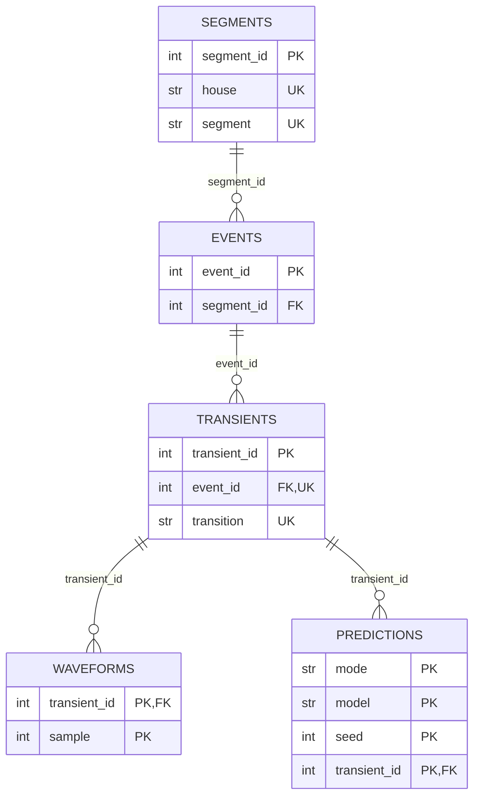

# Data dictionary

Generated from `nilm/schema.py` with `python -m nilm.schema docs/data_dictionary.md`.
Paths are relative to `--output-dir`. Before anything is written, every table is checked
against this definition (columns, types, empty values, allowed values, primary and unique
keys) and every foreign key is checked against the table it points to.

PK = primary key, FK = foreign key, UK = unique key.

## segments

`data/segments.csv`: one row per tagged day folder. Primary key: `segment_id`. Unique: `house`, `segment`.

| Column | Type | Key | Description |
|---|---|---|---|
| `segment_id` | int | PK | Segment id, numbered in the order the folders are found. |
| `house` | str | UK | House label, H1 to H4. |
| `segment` | str | UK | Name of the Tagged_Training_* folder (one day of data). |
| `n_tags` | int |  | Rows in this segment's TaggingInfo.csv. |
| `n_usable_events` | int |  | Tags with status ok in this segment. |
| `status` | str |  | Whether the power was loaded. One of: `loaded`, `not_needed`, `load_failed`. |
| `source` | str, nullable |  | Where the power came from. One of: `parsed`, `cache`. |
| `n_phases` | int, nullable |  | Phases summed into the aggregate power (1 or 2). |
| `n_samples` | int, nullable |  | Samples after trimming and dropping out-of-order timestamps. |
| `sampling_rate_hz` | float, nullable |  | Samples per second over the day. |
| `n_rows_trimmed` | int, nullable |  | Rows of the longest file beyond the common length. |
| `n_out_of_order` | int, nullable |  | Samples dropped because their timestamp went backwards. |
| `start_time` | datetime, nullable |  | First sample (UTC). |
| `end_time` | datetime, nullable |  | Last sample (UTC). |
| `error` | str, nullable |  | Why loading failed. |

## events

`data/events.csv`: one row per tag (one appliance use). Primary key: `event_id`.

| Column | Type | Key | Description |
|---|---|---|---|
| `event_id` | int | PK | Event id, numbered in the order the tags are read. |
| `segment_id` | int | FK -> `segments.segment_id` | Segment the tag belongs to. |
| `appliance_id` | int, nullable |  | Belkin's appliance id within the house. |
| `appliance` | str |  | Appliance name as written in TaggingInfo.csv. |
| `start_ts` | float |  | Tagged start, Unix seconds. |
| `end_ts` | float |  | Tagged end, Unix seconds. |
| `start_time` | datetime |  | Tagged start (UTC). |
| `end_time` | datetime |  | Tagged end (UTC). |
| `duration_sec` | float |  | end_ts - start_ts. |
| `has_overlap` | bool |  | Interval overlaps another tag (any appliance) in the same segment. |
| `status` | str |  | ok, or the first check the tag failed. One of: `ok`, `not_target`, `zero_duration`, `negative_duration`, `too_few_events`. |

## transients

`data/transients.csv`: one row per tag time (turn-on or turn-off of a used event). Primary key: `transient_id`. Unique: `event_id`, `transition`.

| Column | Type | Key | Description |
|---|---|---|---|
| `transient_id` | int | PK | Transient id, numbered in extraction order. |
| `event_id` | int | FK, UK -> `events.event_id` | Event the tag time belongs to. |
| `transition` | str | UK | Which edge of the event. One of: `on`, `off`. |
| `tag_ts` | float |  | Tagged time searched around (start_ts for on, end_ts for off), Unix seconds. |
| `status` | str |  | ok, or why no transient was extracted. One of: `ok`, `no_signal`, `no_step_found`, `too_short`, `implausible_power`. |
| `step_ts` | float, nullable |  | Detected switching time: last sample before the jump, Unix seconds. |
| `tag_offset_sec` | float, nullable |  | step_ts - tag_ts. Positive means the switch came after the tag. |
| `step_watts` | float, nullable |  | Size of the jump in W (negative for turn-off). |
| `pre_level` | float, nullable |  | Power level before the step (the baseline), W. |
| `post_level` | float, nullable |  | Median power over the 6 s after the step, W. |
| `baseline_std` | float, nullable |  | Std of the 6 s before the step, W. |
| `baseline_stable` | bool, nullable |  | baseline_std <= 30 W. |
| `n_samples` | int, nullable |  | Length of the extracted waveform (rows in waveforms.csv). |
| `transient_duration` | float, nullable |  | Length of the extracted waveform, seconds. |
| `rise_time` | int, nullable |  | Samples between 10% and 90% of the change. |

## waveforms

`data/waveforms.csv`: one row per sample of an extracted transient. Primary key: `transient_id`, `sample`.

| Column | Type | Key | Description |
|---|---|---|---|
| `transient_id` | int | PK, FK -> `transients.transient_id` | Transient the sample belongs to. |
| `sample` | int | PK | Position in the waveform. The cut starts about 1 s before the step; seconds = sample * transient_duration / n_samples. |
| `watts` | float |  | Smoothed power minus pre_level, W. |

## quality_report

`data/quality_report.csv`: one row per data check. Primary key: `stage`, `check`.

| Column | Type | Key | Description |
|---|---|---|---|
| `stage` | str | PK | Pipeline stage the check belongs to. One of: `segments`, `events`, `transients`. |
| `check` | str | PK | Check name; for exclusions this is the status value. |
| `action` | str |  | What happens to affected rows. One of: `use`, `exclude`, `flag`, `fix`. |
| `count` | int |  | Rows (or samples) affected in this run. |
| `unit` | str |  | What count counts. |
| `description` | str |  | What the check means. |

## predictions

`results/predictions.csv`: one row per held-out prediction (one transient, one model, one seed). Primary key: `mode`, `model`, `seed`, `transient_id`.

| Column | Type | Key | Description |
|---|---|---|---|
| `mode` | str | PK | Evaluation mode: turn-on transients, turn-off transients, or both. One of: `turn_on`, `turn_off`, `combined`. |
| `model` | str | PK | Model name; see the README for the list. |
| `seed` | int | PK | Random seed of the run (models without randomness give the same result for every seed). |
| `transient_id` | int | PK, FK -> `transients.transient_id` | Transient that was classified. |
| `house` | str |  | House held out in this fold, which is the transient's own house. |
| `appliance_true` | str |  | Tagged appliance the prediction is scored against. |
| `appliance_predicted` | str |  | Predicted appliance. |
| `correct` | bool |  | appliance_true == appliance_predicted. |

## metrics

`results/metrics.csv`: one row per model in one mode, summarised over seeds. Primary key: `mode`, `model`.

| Column | Type | Key | Description |
|---|---|---|---|
| `mode` | str | PK | Evaluation mode: turn-on transients, turn-off transients, or both. One of: `turn_on`, `turn_off`, `combined`. |
| `model` | str | PK | Model name; see the README for the list. |
| `n_seeds` | int |  | Seeds the model was run with. |
| `accuracy_mean` | float |  | Leave-one-house-out accuracy, mean over seeds. |
| `accuracy_std` | float, nullable |  | Std over seeds (empty for a single seed). |
| `accuracy_min` | float |  | Lowest accuracy over seeds. |
| `accuracy_max` | float |  | Highest accuracy over seeds. |
| `f1_macro_mean` | float |  | Macro F1, mean over seeds. |
| `f1_macro_std` | float, nullable |  | Std over seeds (empty for a single seed). |
| `n_test` | int |  | Held-out transients per seed. |
| `n_folds` | int |  | Houses held out. |

## fold_metrics

`results/fold_metrics.csv`: one row per model in one mode on one held-out house. Primary key: `mode`, `model`, `house`.

| Column | Type | Key | Description |
|---|---|---|---|
| `mode` | str | PK | Evaluation mode: turn-on transients, turn-off transients, or both. One of: `turn_on`, `turn_off`, `combined`. |
| `model` | str | PK | Model name; see the README for the list. |
| `house` | str | PK | Held-out house. |
| `accuracy_mean` | float |  | Accuracy on this house, mean over seeds. |
| `accuracy_std` | float, nullable |  | Std over seeds (empty for a single seed). |
| `f1_macro_mean` | float |  | Macro F1 on this house, mean over seeds. |
| `n_test` | int |  | Held-out transients from this house. |

## feature_importance

`results/feature_importance.csv`: one row per feature of the full random forest in one mode. Primary key: `mode`, `feature`.

| Column | Type | Key | Description |
|---|---|---|---|
| `mode` | str | PK | Evaluation mode: turn-on transients, turn-off transients, or both. One of: `turn_on`, `turn_off`, `combined`. |
| `feature` | str | PK | Feature name; see the README. |
| `importance_mean` | float |  | Drop in held-out accuracy when the feature is shuffled, mean over folds and seeds. |
| `importance_std` | float, nullable |  | Std over folds and seeds. |
| `n_runs` | int |  | Folds x seeds averaged. |

## Data checks

Counted for each run in `data/quality_report.csv`.

| Stage | Check | Action | Counts | Meaning |
|---|---|---|---|---|
| segments | `loaded` | use | segments | power loaded, either parsed from the LF files or read from the cache |
| segments | `not_needed` | exclude | segments | no usable event in this segment, so its power is not loaded |
| segments | `load_failed` | exclude | segments | phase-1 files missing or unreadable |
| segments | `phase_2_missing` | flag | segments | only phase 1 available, so part of the load is missing |
| segments | `rows_trimmed` | fix | samples | rows beyond the shortest LF/TimeTicks file, cut so the files line up |
| segments | `out_of_order_timestamps` | fix | samples | samples dropped because the clock went backwards |
| events | `ok` | use | tags | used |
| events | `not_target` | exclude | tags | appliance is not one of the selected appliances |
| events | `zero_duration` | exclude | tags | tag end equals tag start, so there is no off-time to search around |
| events | `negative_duration` | exclude | tags | tag end is before tag start |
| events | `too_few_events` | exclude | tags | fewer than 2 usable events for this appliance |
| events | `has_overlap` | flag | tags | used tag overlaps another tag in the same segment |
| transients | `ok` | use | tag times | used |
| transients | `no_signal` | exclude | tag times | the segment's power could not be loaded |
| transients | `no_step_found` | exclude | tag times | no step above the threshold within +/-45 s of the tag |
| transients | `too_short` | exclude | tag times | fewer than 5 samples could be cut |
| transients | `implausible_power` | exclude | tag times | level moved more than 20 W against the expected direction |
| transients | `unstable_baseline` | flag | tag times | std of the 6 s before the step is above 30 W (another load is busy) |
